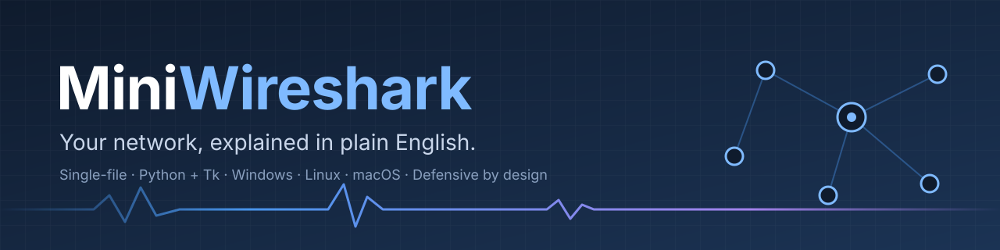
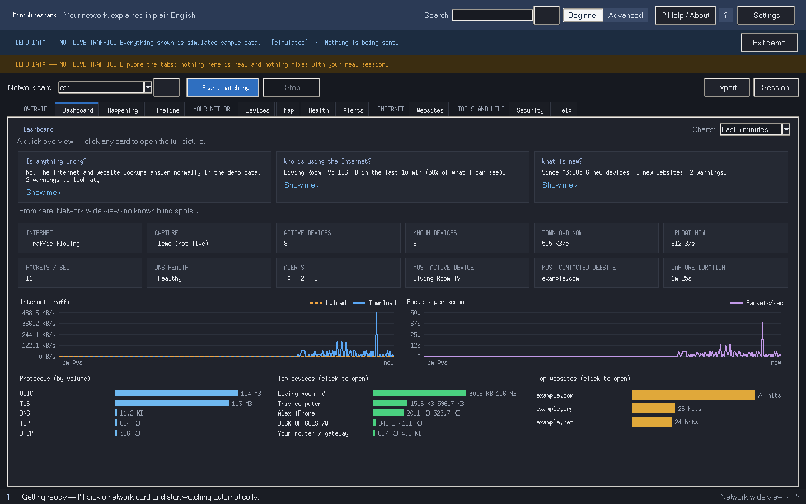
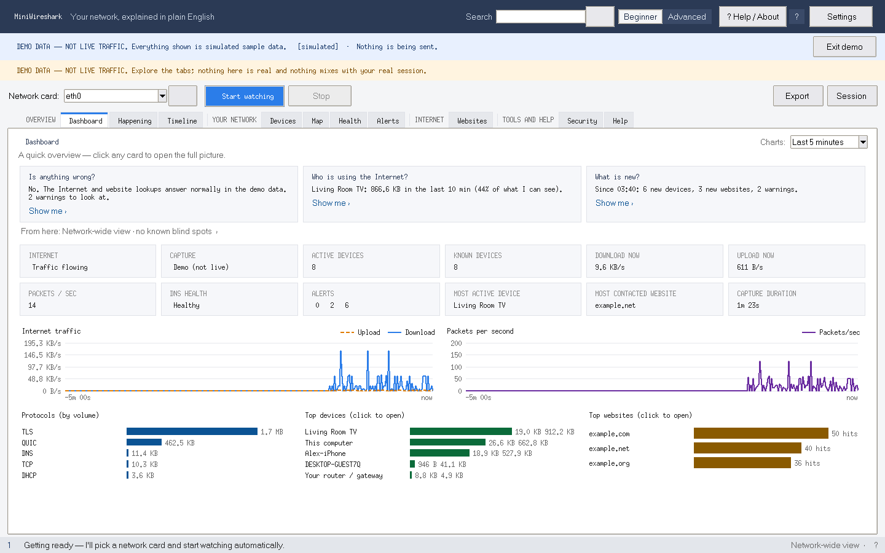

<p align="center">
  
</p>

<p align="center">
  <a href="https://github.com/darkckillerc4/MiniWireshark/releases/latest"></a>
  
  
  
  <a href="LICENSE"></a>
</p>

**MiniWireshark** is a network monitor for people who are not network engineers. It watches the traffic on your own computer and home or office network, then tells you in plain sentences what is connected, who is using the Internet, which websites are being reached, and whether anything looks wrong. It never presents a guess as a fact.

Under the beginner view is a real analysis workstation, with packet dissection, stream reassembly, expert findings, statistics and a filter language. All of it ships as **one Python file**.

<p align="center">
  
  <br><sub>Dashboard in the dark theme, showing the built-in <b>demo data</b> (simulated, <code>.example</code> names). Nothing is captured in Demo Mode.</sub>
</p>

---

## Contents

- [Highlights](#highlights)
- [Quick start](#quick-start)
- [Requirements](#requirements)
- [Privacy and safety](#privacy-and-safety)
- [Testing](#testing)
- [Versions and downloads](#versions-and-downloads)
- [Project layout](#project-layout)
- [Roadmap](#roadmap)
- [Contributing](#contributing)
- [License](#license)

## Highlights

| | |
|---|---|
| **Plain-English answers** | The dashboard answers three questions: "Is anything wrong?", "Who is using the Internet?" and "What is new?" Every card opens the evidence behind it. |
| **Devices, websites and remote hosts kept apart** | A website is a name and never a device. A public address is a remote host and never a device. Each device carries confidence levels and the evidence for them. |
| **Honest coverage** | A vantage meter, blind spots and a coverage report say what MiniWireshark *can't* see from where it sits. |
| **Deep analysis when you want it** | Full Power mode runs every dissector in worker processes and adds TCP reassembly, expert findings, protocol exchanges (DNS, DHCP, TLS, HTTP, SMB, SSH, MQTT, SIP and more), Follow stream, I/O graphs, conversations and a filter language. |
| **Investigations** | "Why is my Internet slow?" checks Wi-Fi, the router, DNS, packet loss, heavy programs and VPNs, and says when it can't tell from here. |
| **Security engine** | Alerts for ARP spoofing, rogue IPv6 router adverts, logins sent before encryption, new listening services, port scans and unusual traffic, with innocent explanations alongside. |
| **History** | An optional SQLite history (WAL, migrations with backups), saved sessions, a crash-safe journal and a flight recorder. |
| **Accessible and multilingual** | English, French and Spanish. Light and dark themes, colour-blind palettes, adjustable text size, full keyboard control and a command palette (`Ctrl+K`). |
| **Self-maintaining** | Installs its own dependencies into a private folder and never into your system Python. Offers to install Npcap on Windows, picks the best network card, heals a capture that dies, and checks Ed25519-signed updates. |

<details>
<summary><b>Light theme</b></summary>
<p align="center"></p>
</details>

## Quick start

```bash
# 1. Download miniwireshark.py from the latest release (or clone this repo)
# 2. Run it
python miniwireshark.py            # Windows: py miniwireshark.py
```

The first start opens a loading screen that checks your setup. It installs what is missing into MiniWireshark's own folder and asks first. Then the Welcome Center lets you choose between watching your network and exploring the **demo**:

```bash
python miniwireshark.py --demo     # simulated data, nothing is captured or sent
```

Useful switches:

| Switch | What it does |
|---|---|
| `--demo` | Start in Demo Mode with simulated, clearly labelled data |
| `--safe` | Safe Mode: conservative settings, no auto-capture |
| `--boot-check` | Check this computer's setup without opening the window |
| `--self-test` | Run the built-in test suite (no admin rights or capture needed) |
| `--gui-test` | Drive the real window through every tab (needs a display) |
| `--bench-gui S1 S2` | Window-performance benchmark against fixed budgets |
| `--release-gate` | Everything above plus pictures of every tab, in one folder |

## Requirements

- **Python 3.8 or newer** with Tk (included with the python.org and Microsoft Store installers on Windows and macOS; on Linux, `sudo apt install python3-tk`).
- **Packet capture:**
  - **Windows:** [Npcap](https://npcap.com/). MiniWireshark offers to install it, and capture works without administrator rights once it is there.
  - **Linux:** root or `CAP_NET_RAW`.
  - **macOS:** access to `/dev/bpf*`.
- **scapy** and optional extras (psutil, cryptography) are installed automatically into a private, per-Python folder.

Without a capture driver, MiniWireshark still opens in limited mode, so you can explore saved sessions, capture files and the demo.

## Privacy and safety

MiniWireshark is a **defensive** tool for networks you own or are allowed to monitor.

- **No telemetry.** Everything MiniWireshark itself sends goes through one gate, `outbound()`, and is listed in a self-traffic ledger. A kill switch blocks all of it.
- **Secrets are dropped inside the parsers.** Mail logins, passwords and message bodies are never stored. A canary test checks reports, sessions, CSV files, logs, history and the clipboard for leaks.
- **Redaction.** Reports and shared screenshots can replace real names and addresses with documentation-range pseudonyms.
- **Active scanning stays on your own subnet,** and Quiet Mode turns it off on networks you haven't trusted.

Found a security issue? See [SECURITY.md](SECURITY.md).

## Testing

```bash
python miniwireshark.py --self-test               # ~35 s, 131+ tests
xvfb-run -a python miniwireshark.py --gui-test    # Linux without a display
python miniwireshark.py --bench-gui S1 S2         # performance budgets
```

Continuous integration runs a syntax check and the self-test on every push and pull request (see [`.github/workflows/ci.yml`](.github/workflows/ci.yml)).

## Versions and downloads

Every release is a single `.py` file attached to its [GitHub release](https://github.com/darkckillerc4/MiniWireshark/releases). The full list, with SHA-256 checksums, is in [docs/VERSIONS.md](docs/VERSIONS.md). The changes are in [CHANGELOG.md](CHANGELOG.md).

| Version | Date | Highlights |
|---|---|---|
| **5.1.2** (latest) | 2026-10-24 | The window stays responsive under load, 150 MB less memory, warm start, release gate |
| 5.0.2 | 2026-10-21 | Layout and loading bug campaign across languages, themes and screen sizes |
| 5.0.1 | 2026-10-20 | Expert-list actions, go-to-packet, safer exports |
| 5.0.0 | 2026-10-20 | Packet workspace, Full Power, protocol exchanges, mail analysis, command palette |
| 4.0.0 | 2026-10-19 | Capture pipeline v2, evidence levels, history store, private Python runtime, signed updates |
| 3.0.0 | 2026-10-19 | "Your network, explained in plain English": the observability workstation |
| 2.0.0 / 1.x | earlier | The original "noob-friendly" single-file sniffer |

## Project layout

```
miniwireshark.py        the application: one file on purpose, ~66k lines in banner-marked regions
legacy/                 versions 1.x and 2.0.0 (written before this repository's history began)
docs/                   version index, images
.github/                CI, issue and PR templates, release notes, archive-release workflow
```

The file's docstring lists every region in order (bootstrap, capture pipeline, protocol decoders, identity model, security engine, `NetworkModel`, persistence, GUI, self-tests). A self-test keeps that list in step with the code.

## Roadmap

**5.2.3** is in progress ([pull request #1](https://github.com/darkckillerc4/MiniWireshark/pull/1)). It is a reliability release:

- Capture starts and recovers without freezing the window.
- Archived versions can share a folder safely.
- Memory stays bounded while the window is minimised.
- Devices are identified correctly on PCs with VPN and virtual adapters.
- Windows fixes, and groundwork for a standalone `.exe`.

## Contributing

Issues and suggestions are welcome; see [CONTRIBUTING.md](CONTRIBUTING.md). The house rules are short: one file, no new dependencies without a reason, every fix comes with a regression test, and privacy defaults never get weaker.

## License

[MIT](LICENSE) © 2026 darkckillerc4.

MiniWireshark is an independent project. It is not affiliated with or endorsed by the Wireshark Foundation or the Wireshark project.
