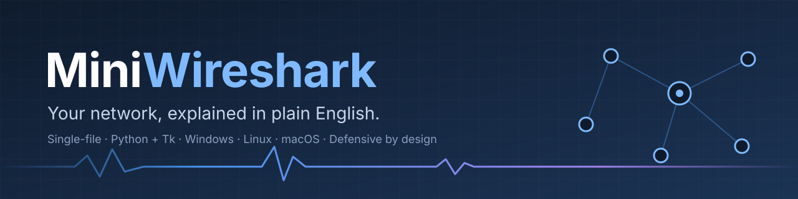
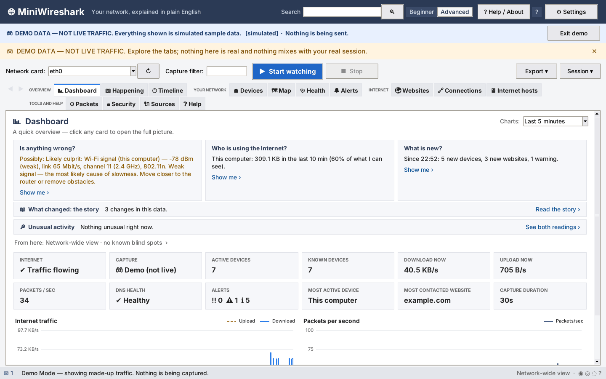
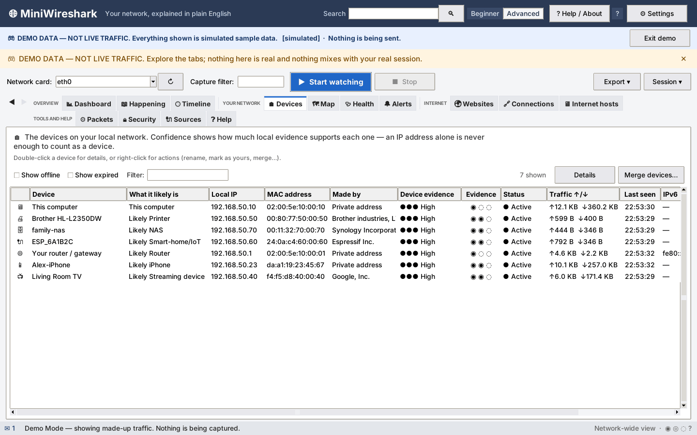
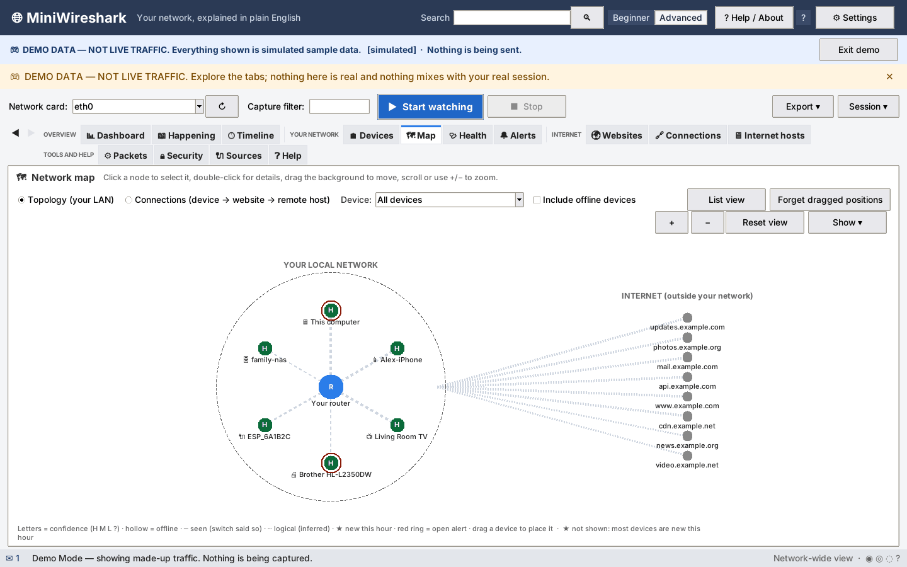
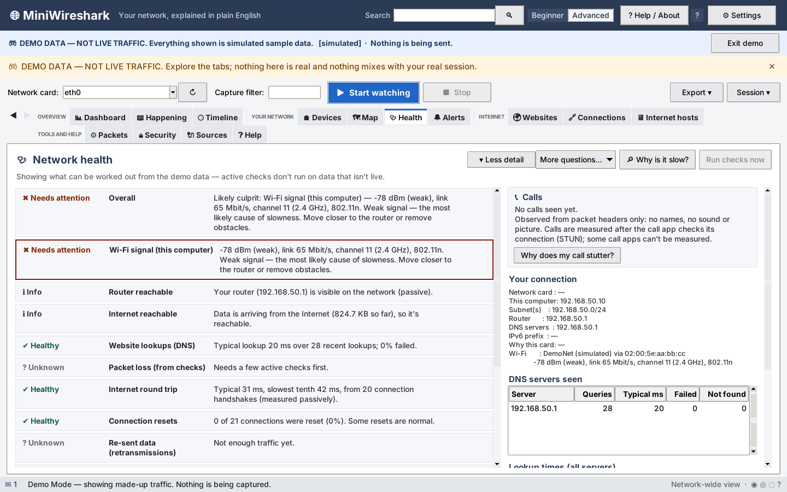
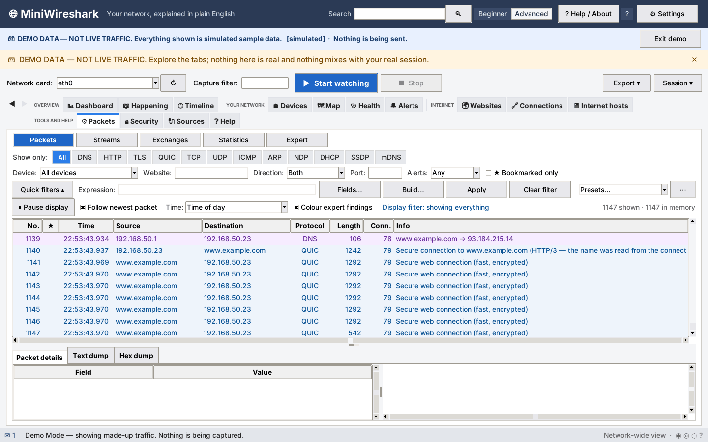
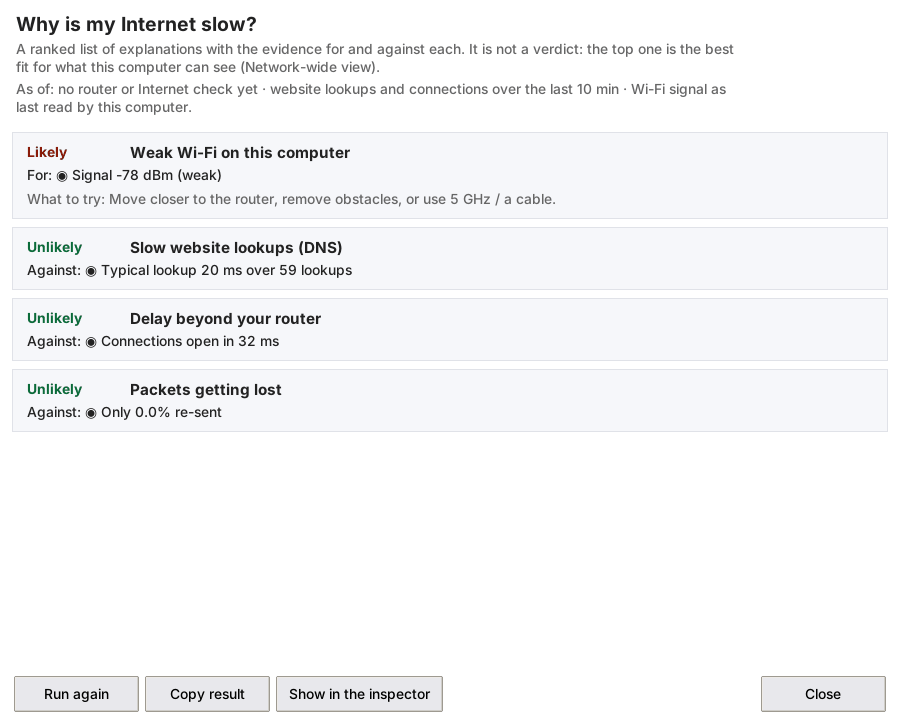
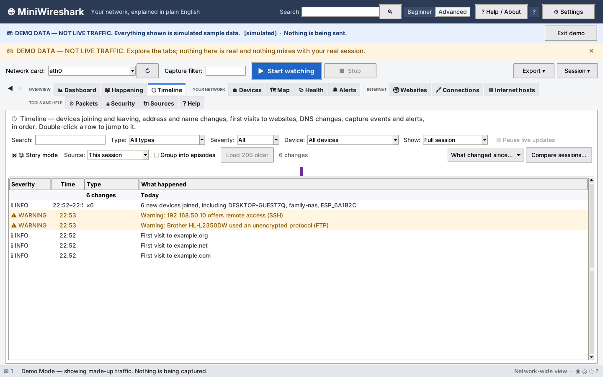

<p align="center">
  
</p>

<p align="center">
  <a href="https://github.com/darkckillerc4/MiniWireshark/releases/latest"></a>
  
  
  
  <a href="LICENSE"></a>
</p>

**MiniWireshark** is a network monitor for people who are not network engineers. It watches the traffic on your own computer and home or office network, then tells you in plain sentences what is connected, who is using the Internet, which websites are being reached, and whether anything looks wrong. It never presents a guess as a fact.

Under the beginner view is a real analysis workstation, with packet dissection, stream reassembly, expert findings, statistics and a filter language. All of it ships as **one Python file**.

<p align="center">
  <picture>
    <source media="(prefers-color-scheme: dark)" srcset="docs/assets/screens/dark-dash.png">
    
  </picture>
  <br><sub>The dashboard showing the built-in <b>demo data</b> (simulated, <code>.example</code> names). Nothing is captured in Demo Mode.</sub>
</p>

---

## Contents

- [Highlights](#highlights)
- [Screenshots](#screenshots)
- [Download](#download)
- [Quick start](#quick-start)
- [Documentation](#documentation)
- [Requirements](#requirements)
- [Privacy and safety](#privacy-and-safety)
- [Your data and uninstalling](#your-data-and-uninstalling)
- [Troubleshooting](#troubleshooting)
- [Testing](#testing)
- [Versions and downloads](#versions-and-downloads)
- [Project layout](#project-layout)
- [Roadmap](#roadmap)
- [Contributing](#contributing)
- [License](#license)

## Highlights

| | | |
|---|---|---|
|  | **Plain-English answers** | The dashboard answers three questions: "Is anything wrong?", "Who is using the Internet?" and "What is new?" Every card opens the evidence behind it. A **Ready?** list at start says what works and how to fix what doesn't, and **Story mode** tells what changed, day by day. |
|  | **Devices, websites and remote hosts kept apart** | A website is a name and never a device. A public address is a remote host and never a device. Each device carries confidence levels and the evidence for them. |
|  | **Honest coverage** | A vantage meter, blind spots and a coverage report say what MiniWireshark *can't* see from where it sits. |
|  | **Deep analysis when you want it** | Full Power mode runs every dissector in worker processes and adds TCP reassembly, expert findings, protocol exchanges (DNS, DHCP, TLS, HTTP, SMB, SSH, MQTT, SIP and more), Follow stream, I/O graphs, conversations and a filter language. |
|  | **Investigations** | Seven guided questions, from "Why is my Internet slow?" to "Is it my Wi-Fi or the Internet?" and "Why does my call stutter?". Each weighs the evidence for and against, and says when it can't tell from here. Call quality (loss and jitter) is read from packet headers only. |
|  | **Security engine** | Alerts for a fake router, rogue IPv6 router adverts, logins sent without encryption, new services, port scans and unusual traffic. **Unusual activity** shows the worrying and the innocent reading side by side. A day-and-night baseline per device, alert snooze, your own blocklist, and opt-in notifications while minimised. |
|  | **History and reports** | An optional SQLite history (WAL, migrations with backups), saved sessions, a crash-safe journal and a flight recorder. A one-page **Network check-up** a beginner can print or send, with names and addresses hidden by default. |
|  | **Accessible and multilingual** | English, French and Spanish. Light and dark themes, colour-blind palettes, adjustable text size, full keyboard control and a command palette (`Ctrl+K`). |
|  | **Self-maintaining** | Installs its own dependencies into a private folder and never into your system Python. Offers to install Npcap on Windows, picks the best network card, heals a capture that dies, and checks Ed25519-signed updates. |

The engineering underneath (a self-installing private Python runtime, a decoder 15× faster than the obvious one, pure-Python AES and Ed25519 fallbacks, more than 260 self-tests) is described in [Under the hood](docs/UNDER-THE-HOOD.md).

## Screenshots

All taken with 5.3.4 in Demo Mode (simulated data, nothing captured), and they follow your GitHub theme. Every tab, in both themes, is in [docs/SCREENSHOTS.md](docs/SCREENSHOTS.md).

<table>
<tr>
<td width="50%"><picture><source media="(prefers-color-scheme: dark)" srcset="docs/assets/screens/dark-devices.png"></picture><p align="center"><b>Devices</b>: type, maker, confidence and evidence</p></td>
<td width="50%"><picture><source media="(prefers-color-scheme: dark)" srcset="docs/assets/screens/dark-map.png"></picture><p align="center"><b>Map</b>: your network as a picture</p></td>
</tr>
<tr>
<td width="50%"><picture><source media="(prefers-color-scheme: dark)" srcset="docs/assets/screens/dark-health.png"></picture><p align="center"><b>Health</b>: Wi-Fi, router, DNS and Internet checks</p></td>
<td width="50%"><picture><source media="(prefers-color-scheme: dark)" srcset="docs/assets/screens/dark-packets.png"></picture><p align="center"><b>Packets</b>: dissection, streams and filters</p></td>
</tr>
<tr>
<td width="50%"><picture><source media="(prefers-color-scheme: dark)" srcset="docs/assets/screens/dark-investigate.png"></picture><p align="center"><b>Guided questions</b>: evidence for and against, ranked (new in 5.3.4)</p></td>
<td width="50%"><picture><source media="(prefers-color-scheme: dark)" srcset="docs/assets/screens/dark-story.png"></picture><p align="center"><b>Story mode</b>: what changed, in plain sentences (new in 5.3.4)</p></td>
</tr>
</table>

## Download

1. Open the [latest release](https://github.com/darkckillerc4/MiniWireshark/releases/latest) and download `miniwireshark-<version>.py` and its `.sha256` file.
2. Check that the two match: `sha256sum` (Linux), `shasum -a 256` (macOS) or `Get-FileHash -Algorithm SHA256` (Windows PowerShell). Every checksum is also in the [version index](docs/VERSIONS.md).
3. Run it with Python, as below. There is no installer.

Download MiniWireshark only from this GitHub page. Copies on other sites may be fake, and MiniWireshark's own update check only ever points here. Step-by-step instructions for each system are in [Installation](docs/INSTALL.md).

## Quick start

```bash
# 1. Download miniwireshark.py from the latest release (or clone this repo)
# 2. Run it
python miniwireshark.py            # Windows: py miniwireshark.py
```

The first start opens a loading screen that checks your setup. It installs what is missing into MiniWireshark's own folder and asks first. Then the Welcome Center lets you choose between watching your network and exploring the **demo**:

```bash
python miniwireshark.py --demo     # simulated data, nothing is captured or sent
```

Useful switches:

| Switch | What it does |
|---|---|
| `--demo` | Start in Demo Mode with simulated, clearly labelled data |
| `--safe` | Safe Mode: conservative settings, no auto-capture |
| `--no-elevate` | Never ask for administrator rights |
| `--boot-check` | Check this computer's setup (the same Ready? list) without opening the window |
| `--self-test [NAME]` | Run the built-in test suite, or only the named tests (no admin rights or capture needed) |
| `--gui-test` | Drive the real window through every tab (needs a display) |
| `--bench-gui S1 S2` | Window-performance benchmark against fixed budgets |
| `--release-gate` | Everything above plus pictures of every tab, in one folder |
| `--help`, `--version` | List every switch, or print the version |

The full list, including the developer switches, is in [Installation](docs/INSTALL.md#command-line-switches).

## Documentation

| | |
|---|---|
| [Installation](docs/INSTALL.md) | Download, verify, start, update and uninstall, on every platform |
| [User guide](docs/USER-GUIDE.md) | The tabs, filters, command palette, shortcuts and settings |
| [Features](docs/FEATURES.md) | Everything MiniWireshark can do, including every alert it raises |
| [Architecture](docs/ARCHITECTURE.md) | How the single file is organised and how a packet becomes an answer |
| [FAQ and troubleshooting](docs/FAQ.md) | Capture problems, Safe Mode, privacy questions |
| [Can I trust it?](docs/TRUST.md) | Check what it sends, keeps and asks for, how it is tested, and its honest limits |
| [Screenshots](docs/SCREENSHOTS.md) | Every tab, in the light and the dark theme |
| [Under the hood](docs/UNDER-THE-HOOD.md) | The runtime manager, fast decoder, signed updates, self-tests and the rest of the engineering |
| [Logo and images](docs/BRANDING.md) | The logo, icons, Windows icon and social preview |
| [Version index](docs/VERSIONS.md) | Every release with its SHA-256 |

## Requirements

- **Python 3.8 or newer** with Tk (included with the python.org and Microsoft Store installers on Windows and macOS; on Linux, `sudo apt install python3-tk`).
- **Packet capture:**
  - **Windows:** [Npcap](https://npcap.com/). MiniWireshark offers to install it, and capture works without administrator rights once it is there.
  - **Linux:** root or `CAP_NET_RAW`. MiniWireshark asks for the password only when capture starts, and not at all when the capability is set.
  - **macOS:** access to `/dev/bpf*`, or the administrator password when capture starts.
- **scapy** and optional extras (psutil, cryptography) are installed automatically into a private, per-Python folder.

Without a capture driver, MiniWireshark still opens in limited mode, so you can explore saved sessions, capture files and the demo.

## Privacy and safety

MiniWireshark is a **defensive** tool for networks you own or are allowed to monitor.

- **No telemetry.** Everything MiniWireshark itself sends goes through one gate, `outbound()`, and is listed in a self-traffic ledger. A kill switch blocks all of it.
- **Updates only from the official GitHub page.** Once a day MiniWireshark makes one request to `api.github.com` for the latest release of [darkckillerc4/MiniWireshark](https://github.com/darkckillerc4/MiniWireshark/releases). Nothing about you is sent, and it only ever points you to that GitHub page: other download sites may be fake. Turn it off in **Settings → Updates & Dependencies**.
- **Secrets are dropped inside the parsers.** Mail logins, passwords and message bodies are never stored. A canary test checks reports, sessions, CSV files, logs, history and the clipboard for leaks.
- **Your data folder is private.** It is closed to other users, and administrator rights are asked for only when capture starts (Linux and macOS).
- **Redaction.** Reports and exports can replace real names and addresses with documentation-range pseudonyms.
- **Active scanning stays on your own subnet,** and Quiet Mode turns it off on networks you haven't trusted.

Skeptical? Good. [Can I trust it?](docs/TRUST.md) shows how to check each of these claims yourself.

Found a security issue? See [SECURITY.md](SECURITY.md).

## Your data and uninstalling

Everything MiniWireshark creates goes into one data folder: `miniwireshark_data/` next to the script when that folder is writable, otherwise `%LOCALAPPDATA%\MiniWireshark` (Windows), `~/Library/Application Support/MiniWireshark` (macOS) or `~/.local/share/miniwireshark` (Linux). Settings are in `miniwireshark_config.json` next to the script.

Those files describe your own network: device names, addresses and saved sessions. Don't attach them to a public issue. **Storage used…** in the command palette (`Ctrl+K`) shows what each part takes.

To uninstall, delete `miniwireshark.py`, the data folder and `miniwireshark_config.json`. The few other places are listed in [Installation](docs/INSTALL.md#uninstalling).

## Troubleshooting

| What you see | What to try |
|---|---|
| No packets at all | On Windows, install [Npcap](https://npcap.com/) (MiniWireshark offers to). On Linux and macOS, accept the password prompt when capture starts. |
| Only this computer's own traffic | That is normal on Wi-Fi and on most switches. The vantage meter in the bottom-right corner says what can and can't be seen from here. |
| It opened in Safe Mode | Two failed starts in a row do that. Start it again normally, and use **Ready?** in the Welcome Center to see what failed. |
| The wrong network card | Pick the right one in **Network card** at the top of the window, then press **Start watching**. |
| It starts slowly the first time | The first start checks your setup and may install packages into its own folder. Later starts are faster. |

More answers are in the [FAQ](docs/FAQ.md). To report a problem, open an [issue](https://github.com/darkckillerc4/MiniWireshark/issues/new/choose).

## Testing

```bash
python miniwireshark.py --self-test               # a few minutes, 260+ tests
xvfb-run -a python miniwireshark.py --gui-test    # Linux without a display
python miniwireshark.py --bench-gui S1 S2         # performance budgets
```

Continuous integration runs a syntax check and the self-test on every push and pull request (see [`.github/workflows/ci.yml`](.github/workflows/ci.yml)).

## Versions and downloads

Every release is a single `.py` file attached to its [GitHub release](https://github.com/darkckillerc4/MiniWireshark/releases), with a `.sha256` file to check it. New versions are published automatically as soon as they land on `main`. The full list, with SHA-256 checksums, is in [docs/VERSIONS.md](docs/VERSIONS.md). The changes are in [CHANGELOG.md](CHANGELOG.md).

| Version | Date | Highlights |
|---|---|---|
| **5.2.3** (latest) | 2026-10-24 | A reliability release: capture starts without freezing, devices are identified correctly on PCs with VPN and virtual adapters, and copies of different versions can share a folder safely |
| 5.1.2 | 2026-10-24 | The window stays responsive under load, 150 MB less memory, warm start, release gate |
| 5.0.2 | 2026-10-21 | Layout and loading bug campaign across languages, themes and screen sizes |
| 5.0.1 | 2026-10-20 | Expert-list actions, go-to-packet, safer exports |
| 5.0.0 | 2026-10-20 | Packet workspace, Full Power, protocol exchanges, mail analysis, command palette |
| 4.0.0 | 2026-10-19 | Capture pipeline v2, evidence levels, history store, private Python runtime, signed updates |
| 3.0.0 | 2026-10-19 | "Your network, explained in plain English": the observability workstation |
| 2.0.0 / 1.x | earlier | The original "noob-friendly" single-file sniffer |

## Project layout

```
miniwireshark.py        the application: one file on purpose, ~89k lines in banner-marked regions
legacy/                 versions 1.x and 2.0.0 (written before this repository's history began)
docs/                   installation, user guide, features, architecture, FAQ, version index
.github/                CI, issue and PR templates, release notes, archive-release workflow
```

The file's docstring lists every region in order (bootstrap, capture pipeline, protocol decoders, identity model, security engine, `NetworkModel`, persistence, GUI, self-tests). A self-test keeps that list in step with the code.

## Roadmap

**5.3.4** is the current release. It is a medium release: the 5.2.3 security audit closed, a Ready? list, Story mode, Unusual activity, seven guided questions, call quality, notifications and a one-page check-up. See the [changelog](CHANGELOG.md).

No later release is planned yet. Waiting for measurements on a real Windows PC: a lower Windows memory limit. The single `.py` file stays until 6.0, which is not opened.

## Contributing

Issues and suggestions are welcome; see [CONTRIBUTING.md](CONTRIBUTING.md). The house rules are short: one file, no new dependencies without a reason, every fix comes with a regression test, and privacy defaults never get weaker.

## License

[MIT](LICENSE) © 2026 darkckillerc4.

MiniWireshark is an independent project. It is not affiliated with or endorsed by the Wireshark Foundation or the Wireshark project.
