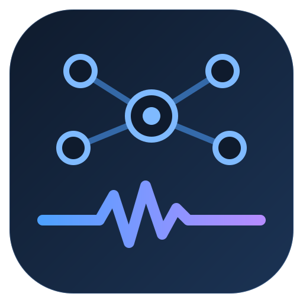
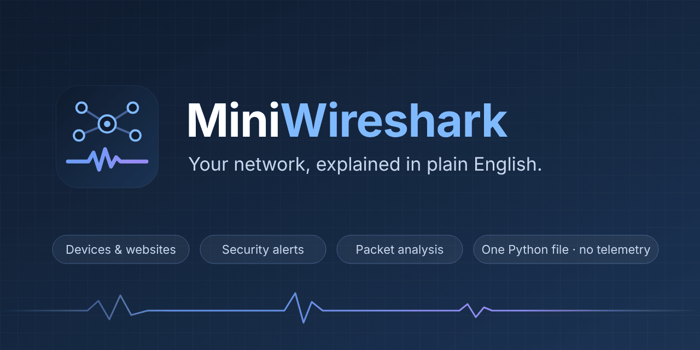

# Logo and images

Everything here is in [`assets/`](assets/), drawn as SVG in the app's own palette (navy `#0f1b2d` to `#1b3354`, accent `#7fbaff`, wave `#4ea1ff` to `#b48cff`). Use them freely when you write about MiniWireshark.

## Logo



A hub with four devices, and the traffic wave from the banner.

| File | Use |
|---|---|
| [`logo.svg`](assets/logo.svg) | Any size, web pages, documents |
| [`logo-512.png`](assets/logo-512.png) | Avatars, app stores, places that don't take SVG |
| [`logo.ico`](assets/logo.ico) | Windows icon (16, 32, 48, 64 and 256 px), for shortcuts and a future `.exe` |

## Banner and social preview



| File | Use |
|---|---|
| [`banner.svg`](assets/banner.svg) | The top of the README |
| [`social-preview.png`](assets/social-preview.png) | The card shown when the repository link is shared (1280×640) |

To use the social preview on GitHub: open the repository's **Settings → General → Social preview → Edit → Upload an image** and choose `docs/assets/social-preview.png`. GitHub only accepts this upload from the website.

## Icons

One icon for each area of the app, 48×48 SVG. They are used in the README and in [Under the hood](UNDER-THE-HOOD.md).

| | | | | | |
|:-:|:-:|:-:|:-:|:-:|:-:|
| <br>devices | <br>websites | <br>alerts | <br>health | <br>map | <br>packets |
| <br>investigate | <br>history | <br>privacy | <br>shield | <br>capture | <br>accessibility |
| <br>self-maintaining | <br>tests | <br>speed | | | |

## Screenshots

28 pictures, every tab in the light and the dark theme, all from Demo Mode. See [Screenshots](SCREENSHOTS.md). To take them again after a change to the window, run the release gate, which photographs every tab:

```bash
xvfb-run -a python miniwireshark.py --release-gate
```
