# Screenshots

Every tab of MiniWireshark 5.1.2, taken in **Demo Mode**: the data is simulated and every name is a reserved `.example` name. Nothing was captured.

The pictures follow your GitHub theme: switch between light and dark to see both. All 28 files are in [`assets/screens/`](assets/screens/).

## Dashboard

Three questions answered at a glance: is anything wrong, who is using the Internet, and what is new. Every card opens its evidence.

<picture>
  <source media="(prefers-color-scheme: dark)" srcset="assets/screens/dark-dash.png">
  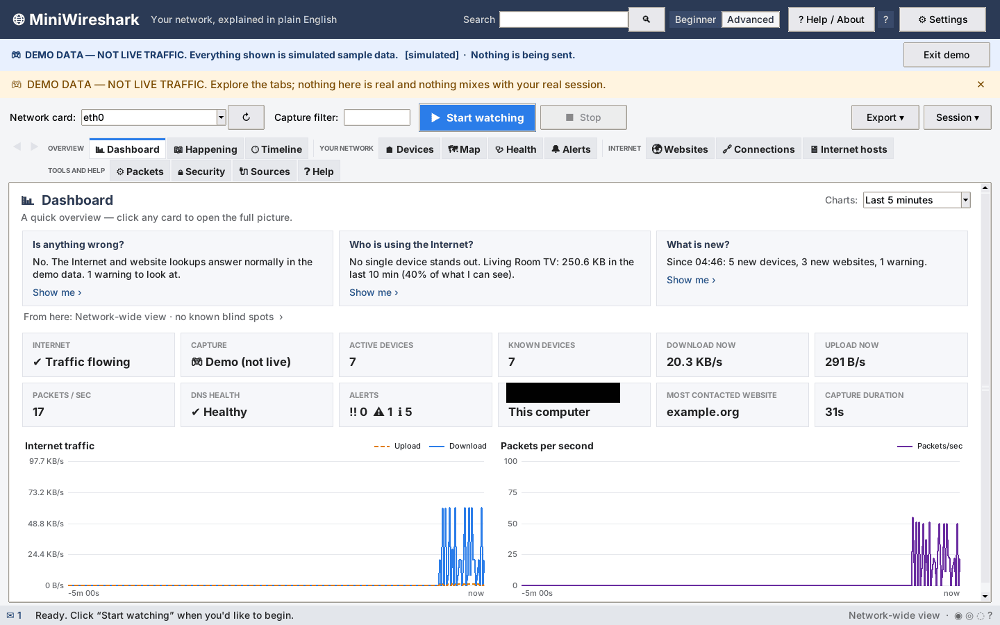
</picture>

## Happening

A plain-English feed of what the network is doing right now.

<picture>
  <source media="(prefers-color-scheme: dark)" srcset="assets/screens/dark-feed.png">
  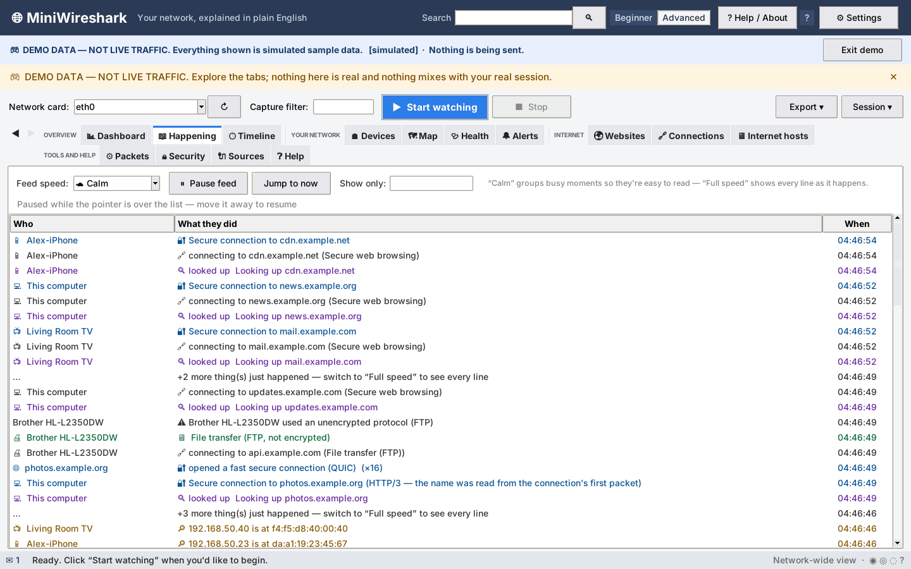
</picture>

## Timeline

Devices joining and leaving, alerts and changes, in order, with filters.

<picture>
  <source media="(prefers-color-scheme: dark)" srcset="assets/screens/dark-timeline.png">
  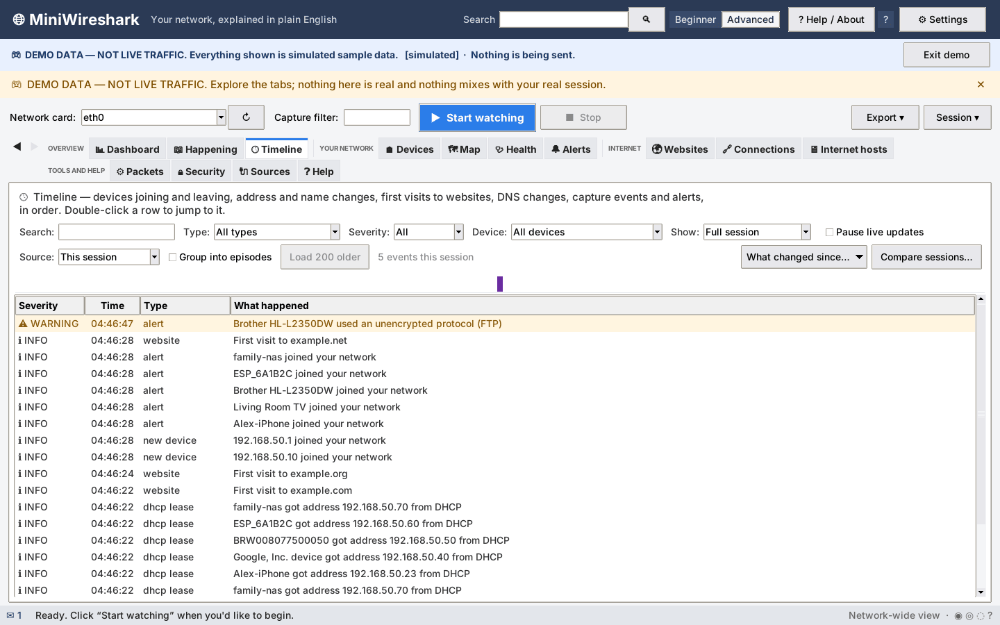
</picture>

## Devices

Everything on your network with its type, maker, confidence level and evidence.

<picture>
  <source media="(prefers-color-scheme: dark)" srcset="assets/screens/dark-devices.png">
  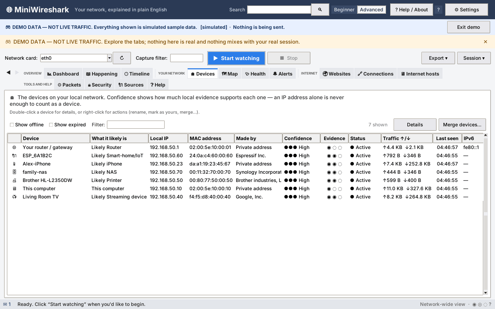
</picture>

## Map

Your network as a picture: router, devices, and the Internet beyond.

<picture>
  <source media="(prefers-color-scheme: dark)" srcset="assets/screens/dark-map.png">
  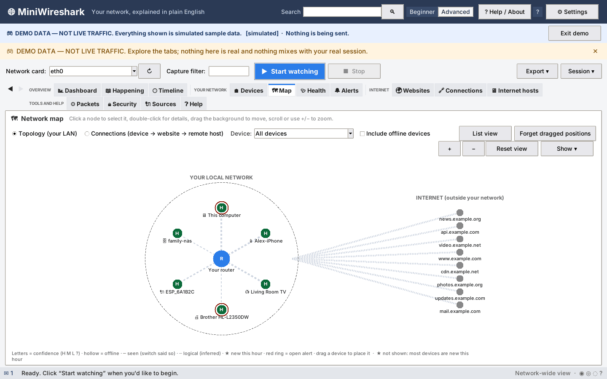
</picture>

## Health

Wi-Fi, router, DNS and Internet checks, with what each result means.

<picture>
  <source media="(prefers-color-scheme: dark)" srcset="assets/screens/dark-health.png">
  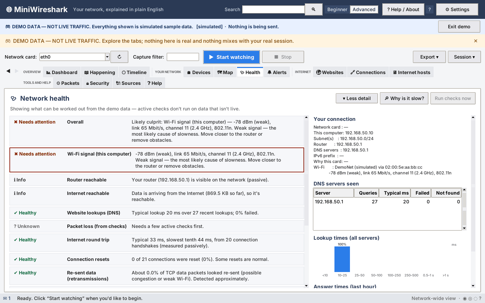
</picture>

## Alerts

Security and health findings, each with why it was flagged and what to check.

<picture>
  <source media="(prefers-color-scheme: dark)" srcset="assets/screens/dark-alerts.png">
  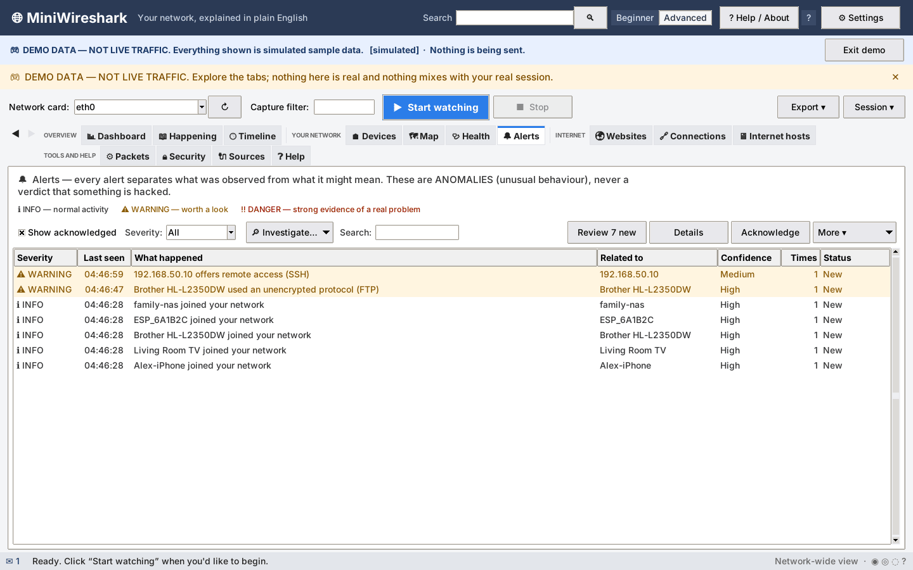
</picture>

## Websites

The sites your devices reach, grouped by name, with trackers marked.

<picture>
  <source media="(prefers-color-scheme: dark)" srcset="assets/screens/dark-websites.png">
  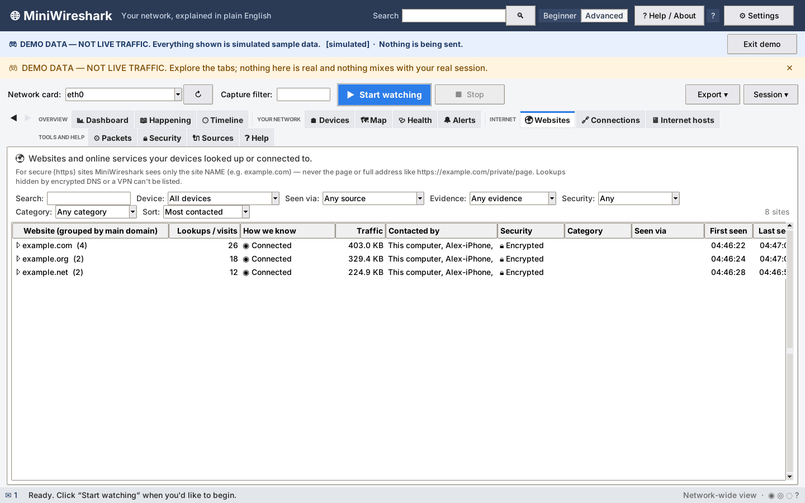
</picture>

## Connections

Every flow: who, where, how much and for how long.

<picture>
  <source media="(prefers-color-scheme: dark)" srcset="assets/screens/dark-connections.png">
  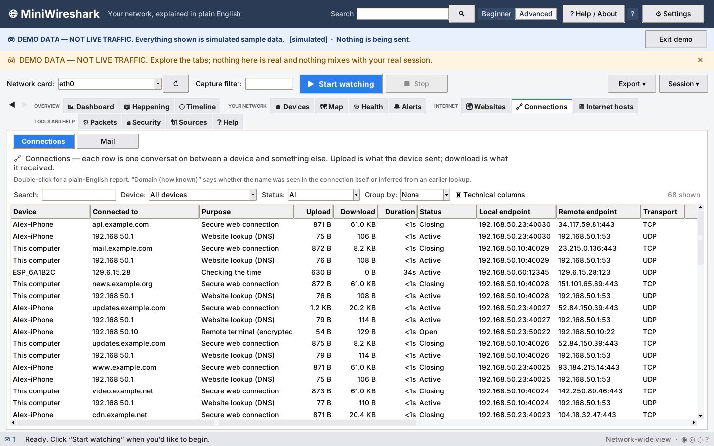
</picture>

## Internet hosts

Public addresses contacted, kept apart from your own devices.

<picture>
  <source media="(prefers-color-scheme: dark)" srcset="assets/screens/dark-remote.png">
  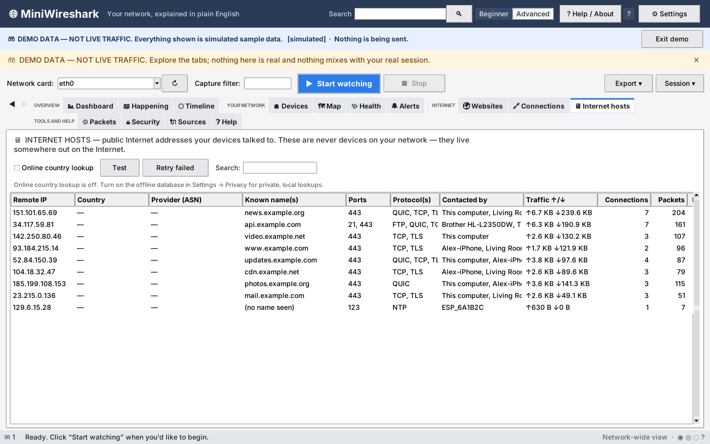
</picture>

## Packets

The packet workspace: list, dissection tree, hex view, streams and filters.

<picture>
  <source media="(prefers-color-scheme: dark)" srcset="assets/screens/dark-packets.png">
  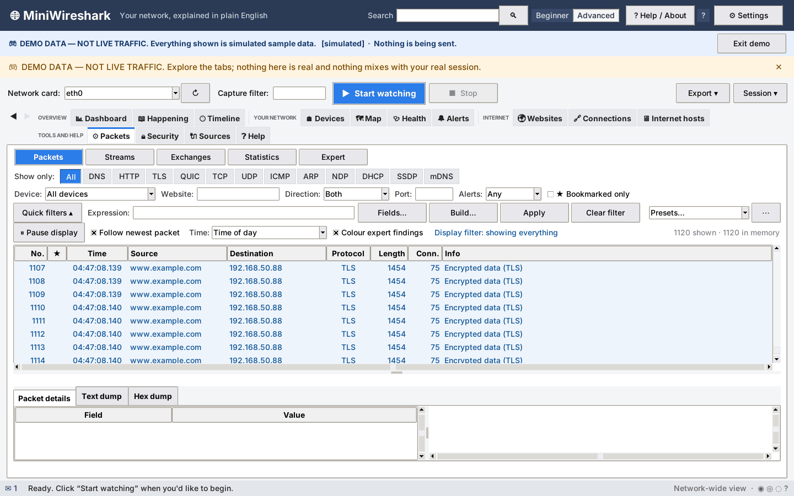
</picture>

## Security

Your router, DHCP, DNS and encryption checked, in plain sentences.

<picture>
  <source media="(prefers-color-scheme: dark)" srcset="assets/screens/dark-security.png">
  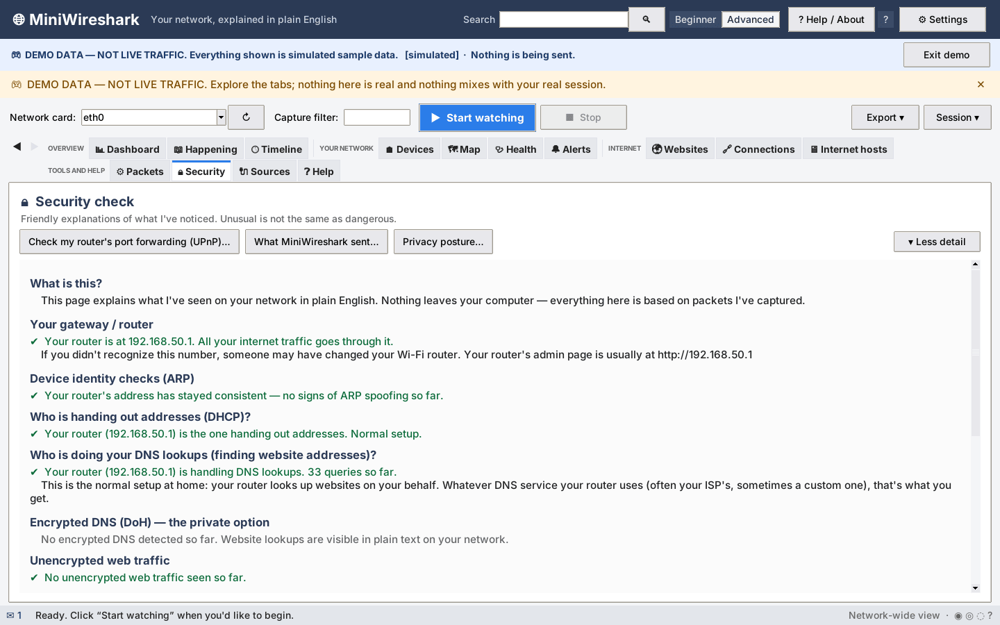
</picture>

## Sources

Where every piece of information comes from, and how much to trust it.

<picture>
  <source media="(prefers-color-scheme: dark)" srcset="assets/screens/dark-sources.png">
  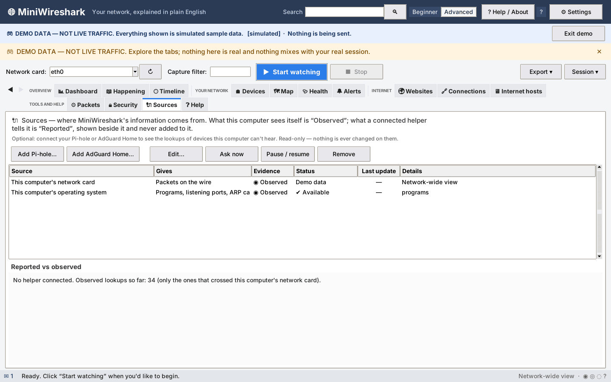
</picture>

## Help

Built-in guides, a glossary and the Quick Start.

<picture>
  <source media="(prefers-color-scheme: dark)" srcset="assets/screens/dark-help.png">
  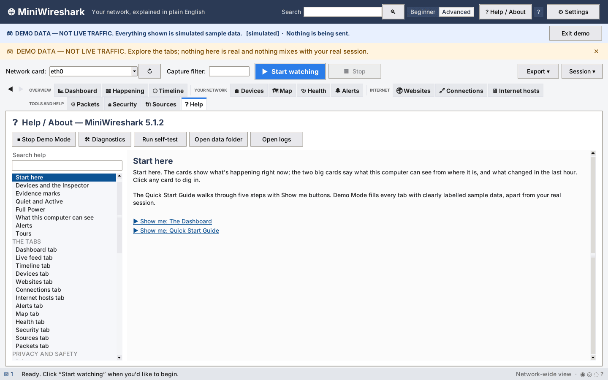
</picture>
